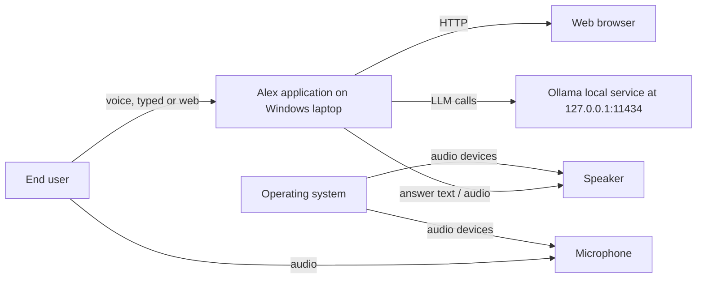

# Alex — System Design

This document describes the technical implementation of the Alex Personal AI Assistant: components, data flows, storage, permissions, API surface and operational behaviour as coded.

## 1. System context



## 2. Component and module design

| Component | Type | Responsibility |
| --- | --- | --- |
| `Chatapp.py` | Module / orchestrator | Owns voice loop, STT, LLM, TTS, FastAPI app, threads, lifecycle |
| `WakeWordListener` (function `listen_for_wake_word`) | Function / thread | Vosk wake detection, activation, conversation loop |
| `UtteranceRecorder` (functions `record_request`, `record_active_utterance`) | Functions / thread | Frame collection, silence/VAD handling, transcription |
| `LLMClient` (function `get_answer`) | Function / thread | Ollama streaming call, sentence flush, history update |
| `TTS` (functions `get_tts`, `synthesize`, `speak_text`, `speak_reply`) | Functions / thread | Kokoro synthesis, playback, interrupt handling |
| `LocalCommandHandlers` | Chain in `process_text` | `permissions.handle_pending`, `reminders.handle`, `permissions.handle`, `local_time_answer` |
| FastAPI app | Class instance (`app = FastAPI(...)`) | HTTP endpoints, origin protection |
| `ReminderScheduler` (module `reminders`) | Thread | Polls tasks, fires callback |

## 3. Key functions and call relationships

### Voice path

```
main()
  -> request_microphone_consent()
  -> get_tts() / VoskModel / WhisperModel
  -> start_ui()
  -> keyboard_listener()
  -> stop_command_monitor(vosk_model)
  -> reminders.start_scheduler(on_reminder_due)
  -> listen_for_wake_word(vosk_model, whisper_model)

listen_for_wake_word()
  -> record_active_utterance(whisper_model)
  -> transcribe_audio(whisper_model, frames)
  -> process_text(transcript)
  -> get_answer(request_text)          # or local handlers
  -> speech_queue -> speech_worker -> speak_text -> synthesize -> sd.play

get_answer(user_text)
  -> _conversation_history (user/assistant)
  -> build_system_prompt()
  -> POST Ollama /api/chat (stream)
  -> flush sentences -> speech_queue
```

### Command path

```
process_text(user_text)
  -> handle_command(request_text)     # :voice, :help, exit/stop, repeat-off
  -> local handlers chain:
      permissions.handle_pending("voice", text)
      -> reminders.handle(text)
      -> permissions.handle(text, "voice")
      -> local_time_answer(text)
  -> get_answer(text)                  # when no local answer applies
```

## 4. Data flows

### 4.1 User voice input → assistant response → audio output

1. `sd.InputStream` callback (`microphone_callback`) pushes int16 frames into `audio_queue` (or `control_audio_queue` while muted).
2. `listen_for_wake_word` consumes frames via Vosk (pre-roll buffer kept).
3. On wake: `speak_reply(WAKE_RESPONSE)` → `speech_queue` → `speech_worker` → Kokoro → `sd.play`.
4. In continuous mode: `record_active_utterance` gathers frames until pause, `transcribe_audio` (faster-whisper) produces text.
5. `process_text` → local handler or `get_answer` → Ollama streaming → sentence-by-sentence push to speech queue → `speak_text`.
6. Response playback polls `STOP_EVENT` / `INTERRUPT_SPEECH`; `sd.stop()` interrupts.

### 4.2 Web chat input → response

`POST /api/chat` validates local UI origin, runs the same local-handler chain with channel `web:<conversation_id>`, streams NDJSON replies, maintains in-memory history.

### 4.3 Reminder flow

Scheduler thread every 5 s calls `_due_now()`; due tasks are marked `notified` and callback `on_reminder_due` speaks when Alex is idle.

## 5. Data storage

### 5.1 Task store — `data/tasks.json`

JSON array of task objects (no SQL database is used):

```json
[
  {
    "id": "<8-char hex>",
    "text": "Task text as spoken",
    "due": "2026-11-07T15:22:00 or null",
    "created": "2026-11-07T15:21:12",
    "done": false,
    "done_at": null,
    "notified": false
  }
]
```

- Atomic write via temp file + `os.replace`.
- Completed tasks older than 14 days are purged.

### 5.2 Audit log — `data/audit.log`

JSON Lines, one event per line:

```json
{"time": "...", "event": "requested", "kind": "open_app", "target": "...", "note": ""}
```

Events observed: `requested`, `approved`, `denied`, `refused`, `expired`, `declined`, `error`. Only paths/decisions are logged, never file contents.

### 5.3 Conversation history

- Voice: module-level `_conversation_history` list, reset per run, trimmed to last 8 messages / 1500 chars context budget.
- Web: `_web_histories` keyed by `conversation_id`, trimmed to last 8 messages.

No database server is used.

## 6. Permission enforcement and single-use approval flow

Implemented in `permissions.py`.

1. `handle(text, channel)` classifies the request via regexes (`_READ`, `_LIST`, `_SITE`, `_APP`, `_COMM`, `_DENY`).
2. Non-matching / denied → return `None` (normal flow continues) or a spoken refusal.
3. Matched action → `_ask(...)` stores pending action with expiry (`APPROVAL_TTL = 60 s`) in `_pending[channel]` and returns an approval question.
4. Next message on same channel (`handle_pending`) consumes the pending action; only an exact `yes` runs the action; anything else cancels.
5. Audit events written for requested / approved / denied / refused / expired / declined / error.

Security boundaries implemented: blocked drive (`C:`), `..` path segments, UNC/device paths, alternate data streams, device names, symlink/junction refusal, credential-like name blocklist, text-extension allowlist, 256 KB read cap, 50 item list cap.

## 7. Security boundaries and file access restrictions

- `permissions.py` is the only component allowed to touch the filesystem on behalf of the assistant.
- All reads go through `_authorize` → `_clean_resolve` → path checks at execution time.
- No write / delete / move / send / install operations are implemented; `_DENY` regex refuses such phrasing early.

## 8. Configuration and environment

| Setting | Source | Value / example |
| --- | --- | --- |
| Ollama URL | `Chatapp.py` | `http://127.0.0.1:11434/api/chat` |
| LLM model | `Chatapp.py` | `qwen2.5:1.5b` |
| UI host / port | `Chatapp.py` | `127.0.0.1:8081` |
| UI file | `Chatapp.py` | `index.html` |
| Vosk model dir | `Chatapp.py` | `models/vosk-model-small-en-us-0.15` |
| Kokoro model / voices | `Chatapp.py` | `models/kokoro/kokoro-v1.0.int8.onnx`, `voices-v1.0.bin` |
| Approvals TTL | `permissions.py` | 60 s |
| Tasks file | `reminders.py` | `data/tasks.json` |
| Audit file | `permissions.py` | `data/audit.log` |
| Allowlists | `security_config.json` | `allowed_folders`, `allowed_apps`, `allowed_websites` |

No secrets or personal values are stored in code; allowlist entries contain local executable paths that must be configured by the user.

## 9. API reference

| Method | Path | Auth | Request | Response |
| --- | --- | --- | --- | --- |
| GET | `/api/health` | Origin check | – | `{"ok": true}` |
| GET | `/api/state` | Origin check | – | `{"state", "voice", "heard", "reply"}` |
| GET | `/api/time` | Origin check | – | `{"time", "date", "day", "iso"}` |
| GET | `/api/tasks` | Origin check | – | `{"tasks": [...], "done": [...]}` |
| POST | `/api/chat` | Local UI origin | `WebChatIn {conversation_id, message}` | NDJSON stream of `{"content": "...", "done": bool}` |
| POST | `/api/transcribe` | Local UI origin | multipart `audio` file (≤ 20 MB) | `{"text": "..."}` |
| GET | `/` | – | – | Serves `index.html` |

Error responses: `400` (empty message), `403` (origin), `413` (audio too large), `422` (empty transcription), `500` (STT failure).

## 10. Error handling, logging and shutdown

- LLM errors: connection refused / timeout / request errors handled; user-facing fallback messages.
- TTS errors are caught and printed; playback errors do not crash the loop.
- Whisper errors return an empty transcript.
- Logging is via `print` statements plus the JSONL audit log; no formal logging framework is used.

Shutdown sequence: stop events set → scheduler stopped → mic muted → playback stopped → queues cleared → speech worker stopped → control thread stopped → UI server thread is daemon.

## 11. Installation, startup and runtime dependencies

- Python 3.11, packages from `requirements-web.txt` (fastapi, uvicorn, pydantic, python-multipart, requests, numpy, sounddevice, onnxruntime, kokoro-onnx, faster-whisper, vosk).
- Local Ollama service with model `qwen2.5:1.5b`.
- Vosk and Kokoro model files under `models/`.
- Run: `python Chatapp.py` (voice + UI) or `python Chatapp.py --web` (UI only).

## 12. Security risks, limitations and recommendations

### Identified risks / limitations

- Approvals and allowlists live in process memory (reset on restart); approval expiry is time-based only.
- Local web API is bound to localhost but has no authentication beyond origin checks.
- LLM may follow injected instructions; system prompt restricts behavior but no tool-calling safety layer exists.
- Browser profile caveat when launching approved Chrome.

### Recommendations (not implemented)

- Add persistent storage for history / approvals.
- Add authentication token for the local API.
- Add tests and monitoring.

---

*End of System Design document.*
