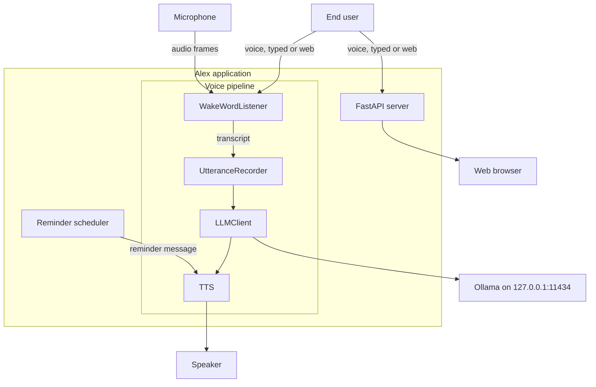
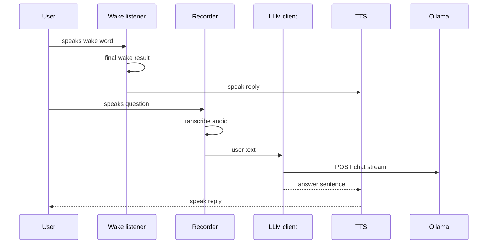

# Alex — System Architecture

This document describes the architecture of the **Alex Personal AI Assistant** as implemented in the current source code.

- `Chatapp.py` — orchestrator, voice pipeline, LLM client, FastAPI app, lifecycle
- `permissions.py` — read-only laptop access policy engine
- `reminders.py` — task / reminder persistence and scheduler
- `index.html` — the "Queen" web UI served by FastAPI
- `security_config.json` — approved apps / websites / folders
- `requirements-web.txt` — Python dependencies

> **Source of truth:** the code. This document reflects the code as it exists today. Planned or older documentation is treated only as supporting context and is never used as proof that a feature works.

## 1. Purpose and scope

Alex is a voice-first personal AI assistant that runs **locally** on a Windows laptop. It waits for a wake word, listens to continuous speech, transcribes with a local speech model, answers with a local LLM, and speaks the answer aloud. It also exposes a small local web interface and supports task reminders and strictly read-only laptop access.

## 2. Architectural overview

The application is a **single Python process** that contains both the voice pipeline and a FastAPI web server. There is no separate backend or frontend process; the frontend is a static HTML file served by the same process.

## 3. Major modules and responsibilities

| Module | File | Responsibility |
| --- | --- | --- |
| Orchestrator / voice pipeline | `Chatapp.py` | Wake word detection, utterance recording, speech-to-text, LLM call, TTS glue, command handling, FastAPI app, application lifecycle |
| Permission engine | `permissions.py` | Deny-by-default laptop access policy (read files / list folders / open approved sites / launch approved apps) with single-use approvals |
| Task / reminder store | `reminders.py` | Task CRUD, time parsing, persistence to `data/tasks.json`, due-task scheduler |
| Web frontend | `index.html` | "Queen" UI: state display, conversation display, task queue, waveform animation, diagnostics |
| Web backend | `Chatapp.py` (`FastAPI` app) | Local HTTP API: health, state, time, tasks, chat (streaming), transcribe (audio upload) |
| Configuration | `security_config.json` | Allowlists: approved apps, approved websites, approved folders |
| Dependencies | `requirements-web.txt` | Python packages |

## 4. Voice pipeline

The voice path is implemented entirely in `Chatapp.py`:

1. **Microphone consent** — `main()` asks the user for microphone access before any audio input stream is opened (`request_microphone_consent`). Denying stops the assistant.
2. **Model loading** — Kokoro TTS (lazy, warmed up in `main()`), Vosk wake model (`models/vosk-model-small-en-us-0.15`), faster-whisper `base.en` on CPU (`int8`).
3. **Wake word** — Vosk `KaldiRecognizer` consumes frames from `audio_queue` (pre-roll of 1.5 s kept). Only a **final** Vosk result triggers the wake phrase; the phrase regex is `\b(alexa|alex)\b`. `Alex` selects the male voice, `Alexa` the female voice. After activation the assistant enters continuous conversation mode (no wake word needed).
4. **Utterance recording** — `record_active_utterance` collects audio frames until silence (1.0 s) or max duration (12 s) elapses, then `transcribe_audio` runs faster-whisper (`en`, `beam_size=1`, VAD enabled).
5. **Command / answer handling** — `process_text` strips a leading call name, runs local handlers first (`permissions.handle_pending`, `reminders.handle`, `permissions.handle`, `local_time_answer`), otherwise calls `get_answer` → Ollama streaming.
6. **Speech output** — sentence fragments are pushed onto `speech_queue`; the `speech_worker` thread calls `speak_text` → Kokoro `synthesize` → `sounddevice.play`, with interrupt support.

Key voice constants (from `Chatapp.py`): `SAMPLE_RATE = 16000`, `BLOCK_SIZE = 4000`, `MAX_UTTERANCE_SECONDS = 12`, `SILENCE_SECONDS = 1.0`, `SILENCE_THRESHOLD = 250`, pre-roll 1.5 s, whisper `base.en` / CPU / `int8`, Kokoro int8 with 2 intra-op threads, TTS speed `1.05`, TTS voice female `af_heart` / male `am_michael`.

## 5. LLM and local model integration

- Endpoint: `POST http://127.0.0.1:11434/api/chat`
- Model: `qwen2.5:1.5b`
- Streaming enabled (`"stream": true`, `keep_alive: "30m"`), options: `temperature 0.6`, `num_ctx 2048`, `num_predict 160`.
- The assistant answers in 1–3 short sentences, simple English, no markdown, no emojis.
- Conversation context is trimmed to the last `MAX_HISTORY = 8` messages with a character budget of `CONTEXT_CHAR_BUDGET = 1500` before being sent.

## 6. Permission and approval workflow

Implemented in `permissions.py` (see `docs/SystemDesign.md` for details).

- Deny by default; only approved folders / apps / websites are reachable.
- Alex never edits the allowlist itself.
- Every laptop action first goes through an approval question ("May I read ...? Say yes to approve or no to cancel."); only an explicit `yes` runs the action.
- Approvals are single-use and expire after `APPROVAL_TTL = 60` seconds; they are tracked per channel (`voice` or `web:<id>`).

## 7. Persistent memory and conversation history

- Voice conversation history is **in-memory only**, started fresh each run (`_init_managers`); it is not saved to disk.
- Web conversation history is kept per `conversation_id` in `_web_histories` (in-memory only, default `conversation_id: 1`).

## 8. Reminder processing and scheduling

Implemented in `reminders.py`: tasks persisted to `data/tasks.json`, scheduler thread (5 s interval) fires due tasks via callback `on_reminder_due`, which waits until Alex is idle before speaking.

## 9. Web UI and HTTP layer

Implemented in `Chatapp.py` via FastAPI + uvicorn:

- Served at `http://127.0.0.1:8081` (`UI_HOST`, `UI_PORT`).
- Endpoints: `GET /api/health`, `GET /api/state`, `GET /api/time`, `GET /api/tasks`, `POST /api/chat` (NDJSON streaming), `POST /api/transcribe` (multipart audio), `GET /` (UI).
- All `/api/*` routes are protected by an origin check middleware.
- The UI polls `/api/state` every 300 ms and `/api/tasks` every 2 s.

## 10. Startup and shutdown

`python Chatapp.py` starts microphone consent, model loading, UI, input threads, reminder scheduler and the wake-word loop. On `KeyboardInterrupt` (or stop commands) it sets stop events, stops playback, joins threads and stops the scheduler.

`python Chatapp.py --web` starts only the UI plus reminder scheduler (no microphone consent check, no voice loop).

## 11. Dependencies and external services

- **Local LLM service:** Ollama at `http://127.0.0.1:11434` (`ollama serve`, model `qwen2.5:1.5b`).
- **Local models:** Vosk wake model (`models/vosk-model-small-en-us-0.15`), Kokoro (`models/kokoro/kokoro-v1.0.int8.onnx` + `voices-v1.0.bin`).
- **Local runtime:** Python 3.11, `requirements-web.txt`.
- **Hardware:** Windows laptop with microphone and speaker; CPU-based inference.

See `docs/PRD.md` and `docs/SystemDesign.md` for requirements, design details and the API reference.
